# 2026-08-02 — The full reactor: every chart, every gesture, every modality

A complete architecture view of the vizform chart system — all chart
families, all gesture types, all modalities, the reactivity model, the
draft/commit/cancel lifecycle, cross-view sync, drill, reorder,
conservation, and the cell propagation that ties it together. Mermaid
diagrams throughout.

This is the **target architecture** — what we're building toward. Current
breakage is cited as contrast, not described as the norm.

---

## 1. The whole reactor at a glance

```mermaid
graph TB
    subgraph DataLayer["DATA LAYER"]
        direction LR
        Reservoir["Reservoir<br/>(BiNode tree — cells)<br/>leaf total cells +<br/>group Num.lens derives"]
        DataModel["Data Models<br/>(per chart family)<br/>build the reservoir,<br/>connect to chart intake"]
    end

    subgraph KernelLayer["KERNEL LAYER (target: cell-aware)"]
        direction LR
        Kernel["Kernel<br/>stores cells, not plain numbers<br/>writeValue = set one cell<br/>writeReorder = swap child array"]
        Drafts["Kernel.Drafts<br/>tracks active editors<br/>global Idle/Drafting state"]
        DrillChannel["Drill Channel<br/>subscribeDrill / publishDrill<br/>cross-view drill sync"]
    end

    subgraph ViewLayer["VIEW LAYER"]
        direction LR
        DataView["DataView<br/>query-keyed subscription<br/>owns an Editor"]
        Editor["Editor<br/>Idle ↔ Drafting<br/>emits draft/commit/cancel/updated"]
        Gesture["Gesture<br/>wraps Editor + store<br/>behavior composition API"]
    end

    subgraph BehaviorLayer["BEHAVIOR LAYER (composable, toggleable)"]
        direction LR
        Wheel["wheel-edit"]
        Keyboard["keyboard-edit"]
        TileDrag["tile-body-drag"]
        TileReorder["tile-body-reorder"]
        EdgeHandle["edge-handle-drag"]
        Transition["transition-on-updated"]
        Preview["preview-full-render"]
        Capture["capture-order-from-window"]
    end

    subgraph ChartLayer["CHART LAYER"]
        direction LR
        HierBase["HierarchicalChartBase<br/>icicle, sunburst, treemap,<br/>pack, treetable"]
        CartBase["CartesianChartBase<br/>bar, bands, area, line"]
        RadialBase["RadialChartBase<br/>radar, concentric-arc"]
        Gantt["GanttChart<br/>(standalone — custom tween)"]
        Sankey["SankeyChart<br/>(standalone — graph)"]
    end

    subgraph GeometryLayer["GEOMETRY LAYER"]
        direction LR
        RectGeom["Rectilinear geometry<br/>computeLayout, makeTile,<br/>makeHandle, labelWrap"]
        RadialGeom["Radial geometry<br/>computeRadialLayout, makeArc,<br/>makeAngularHandle, per-arc cells"]
        TreemapGeom["Treemap geometry<br/>d3 squarify, 2D affine drill,<br/>frame styling, ghost resize"]
    end

    subgraph BridgeLayer["BRIDGE LAYER"]
        direction LR
        BiAdapter["bi-adapter<br/>legacy BiNode prop facade<br/>target: thin, one-way init"]
        HUD["hud-bridge<br/>hover/selection sync<br/>to HUD overlay"]
        SideTable["side-table<br/>treetable sharing kernel<br/>with icicle"]
    end

    DataLayer -->|"BiNode root"| KernelLayer
    KernelLayer --> ViewLayer
    ViewLayer --> BehaviorLayer
    BehaviorLayer --> ChartLayer
    ChartLayer --> GeometryLayer
    BridgeLayer -.->|"compat / sync"| ChartLayer
    BridgeLayer -.->|"compat / sync"| KernelLayer
```

**Five layers, each with a single responsibility:**

1. **Data Layer** — the BiNode reservoir (cells). The source of truth.
2. **Kernel Layer** — pubsub store + draft tracker + drill channel. Target: cell-aware, O(1) writes.
3. **View Layer** — per-chart subscription (DataView), state machine (Editor), behavior host (Gesture).
4. **Behavior Layer** — composable, toggleable gesture handlers. Each is a `(gesture) => () => void` function.
5. **Chart Layer** — chart-specific rendering + geometry. Subclasses provide `_setupRendering()` and `_composeBehaviors()`.

The **Geometry Layer** is extracted from the chart layer — pure functions that map layout cells to shape properties. The **Bridge Layer** handles compatibility (legacy props, HUD sync, side table).

---

## 2. The reactivity model — three tiers

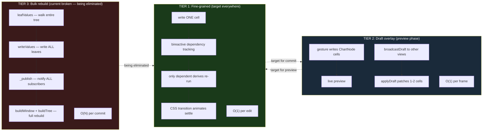

**The goal:** Tier 1 everywhere. The preview phase already uses Tier 2
(draft overlay, O(1) cell patches). The commit phase is stuck in Tier 3
(bulk rebuild, O(N)). The fix: make the Kernel cell-aware so commit is
also Tier 1.

**Why three tiers exist:** the icicle-harness prototype (Jul 16) was
built without bireactive cells in the data layer — `DataNode.value` was
a plain number. The Rebuilder was the bridge. When ported into the
bireactive package (Jul 18), nobody upgraded the data layer to use cells.
The Cartesian charts were built separately (Jul 21) and DO use cells
directly — they're already at Tier 1.

---

## 3. The gesture state machine — universal across all charts

```mermaid
stateDiagram-v2
    [*] --> Idle

    Idle --> Drafting: draft(event)
    note right of Drafting: gesture is a speculative pre-edit<br/>Escape cancels cleanly<br/>commit happens on release

    Drafting --> Drafting: updateDraft(event)
    note right of Drafting: each frame writes to ChartNode cells<br/>broadcastDraft to other views<br/>other views applyDraft (patch 1-2 cells)

    Drafting --> Idle: commit()
    note left of Idle: write to Kernel (target: one cell)<br/>broadcastCommit to other views<br/>CSS transition settles

    Drafting --> Idle: cancel()
    note left of Idle: restore from snapshot<br/>no Kernel write<br/>CSS transition reverts

    Idle --> Idle: updated()
    note right of Idle: external data change, config change,<br/>drill, sort toggle — all are 'updated'<br/>chart transitions to new state
```

**Every gesture — drag, wheel, keyboard, reorder, treetable cell —
flows through this same state machine.** The Editor doesn't know what
kind of gesture it is. The Gesture wraps it with a store (snapshot,
frozenOrder, activeTarget, heldKeys, altHeld). Behaviors produce the
draft events.

**Key invariant:** one gesture, one user, one editor drafting at a time.
`Kernel.Drafts` tracks the global state — if any editor is Drafting, all
charts know. This prevents two simultaneous gestures on different charts.

---

## 4. The behavior composition system

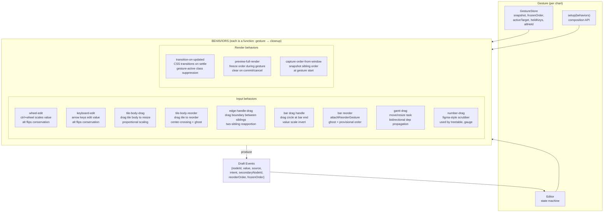

**How behaviors compose:** each behavior is a `(gesture) => () => void`
function. It receives the Gesture (which has the Editor and Store), sets
up event listeners, and returns a cleanup function. The chart's
`_composeBehaviors()` calls `setup()` with a list of behaviors. Adding a
behavior = adding it to the list. Removing = removing from the list.

**How behaviors share state:** the GestureStore is the shared scratch
space. `snapshot` is used by wheel/keyboard/tile-drag for cancel revert.
`frozenOrder` is used by tile-drag/tile-reorder for sort freezing.
`activeTarget` is used by wheel/tile-drag to cache the target at gesture
start. `altHeld` is tracked globally and read by wheel/keyboard for
conservation mode flip.

**How behaviors are toggled:** the chart's `_composeBehaviors()` decides
which behaviors to include based on config. `dragBehavior: "resize"` →
tile-body-drag. `dragBehavior: "reorder"` → tile-body-reorder.
`canReorder: true` → bar reorder. `ghostResize: true` → treemap freezes
siblings. Each chart family composes a different subset.

---

## 5. All chart families — the full matrix

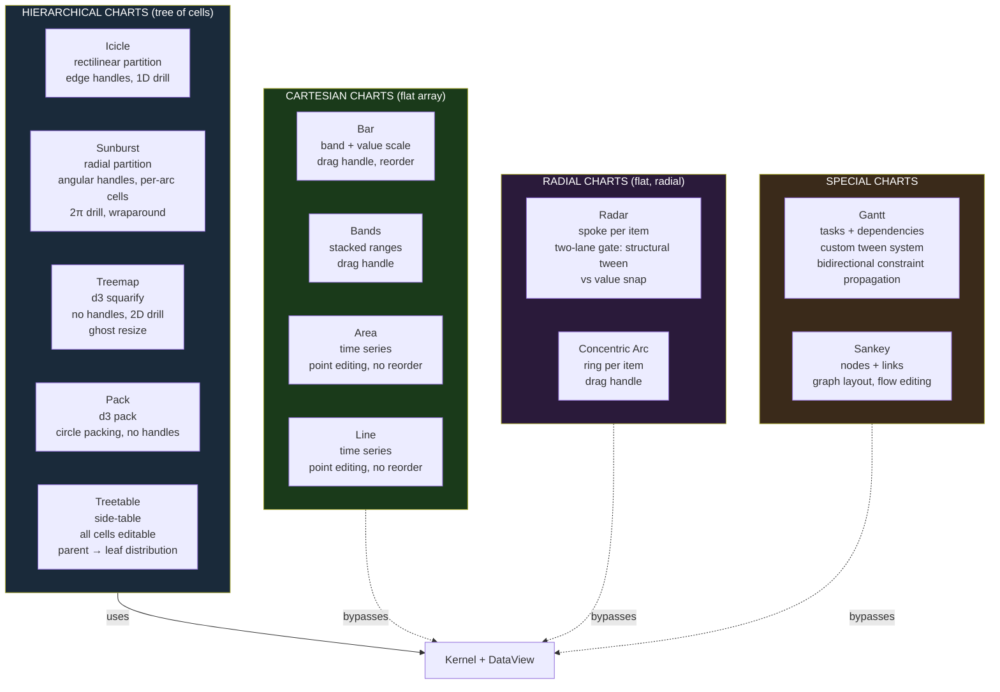

**The fundamental split:** hierarchical charts use the Kernel + DataView
+ Rebuilder pipeline. Cartesian/Radial/Special charts use direct cell
writes — no kernel, no DataView, no rebuild. This split exists because
the hierarchical charts were ported from the icicle-harness (which had
the Kernel), while the Cartesian charts were built fresh on
CartesianChartBase (which uses `dataCell` directly).

**Target:** eliminate the split. One reactivity model. The Kernel becomes
cell-aware, the Rebuilder is retired, and hierarchical charts derive from
cells just like Cartesian charts do.

---

## 6. Every gesture flow — the complete catalog

### 6a. Value edit — single leaf (wheel, keyboard, tile-body-drag)

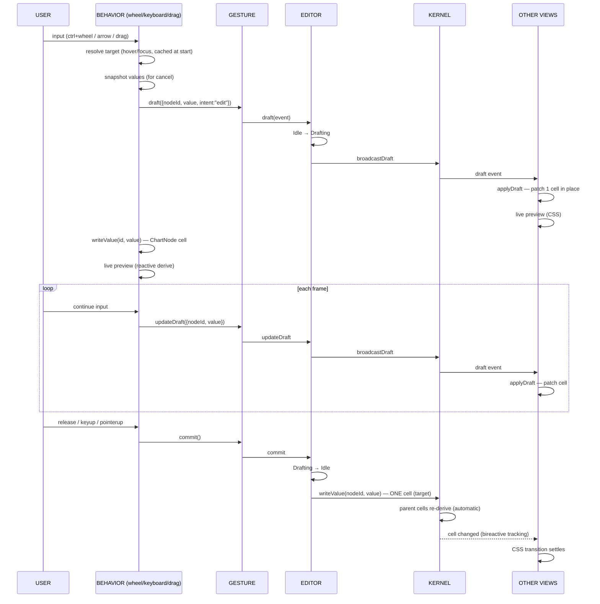

### 6b. Two-sibling reapportion (edge handle drag)

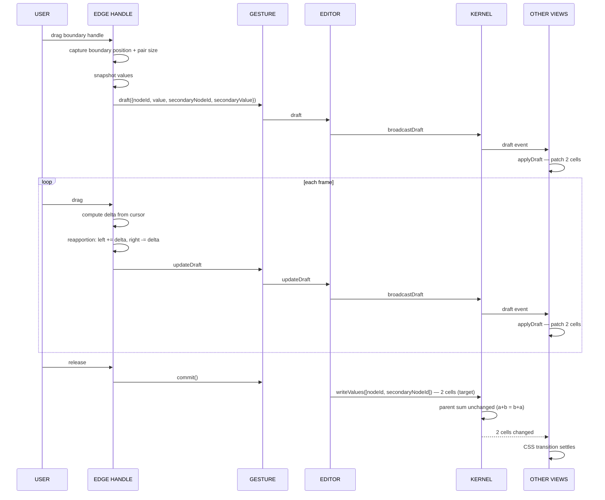

### 6c. Reorder (tile-body-reorder, bar reorder, gantt reorder)

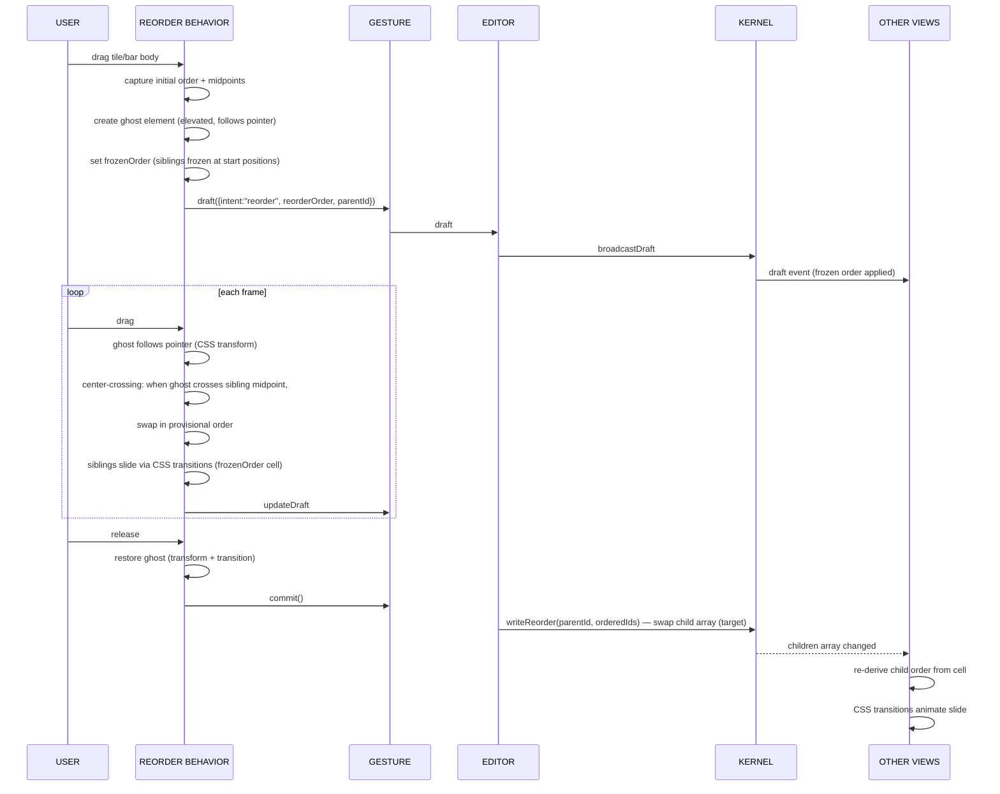

### 6d. Treetable cell edit (primary column)

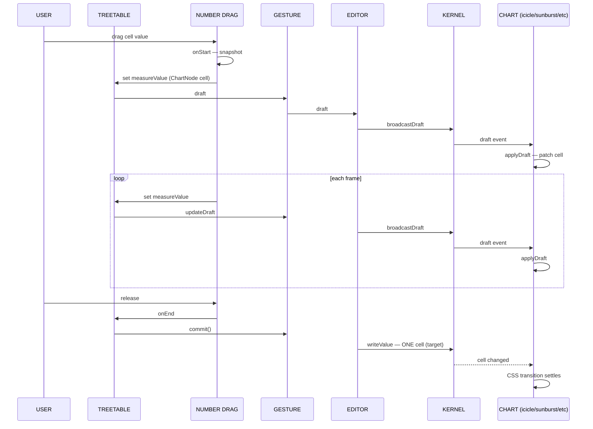

**Target:** the treetable writes to the shared BiNode cell directly. The
kernel reads from the same cell. The chart reads from the same cell via
Num.lens. One write, N readers. No dual-write.

### 6e. Treetable cell edit (extra column / non-primary measure)

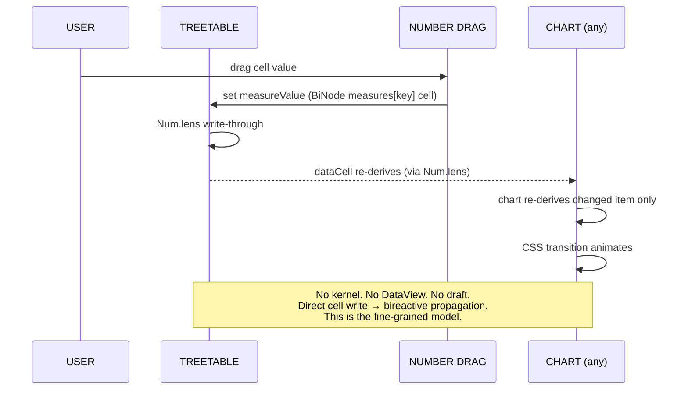

**This is already Tier 1.** Extra column edits bypass the kernel entirely
and go straight through the BiNode cell → Num.lens → dataCell → chart.
This is the model ALL edits should follow.

### 6f. Gantt task drag (with dependency propagation)

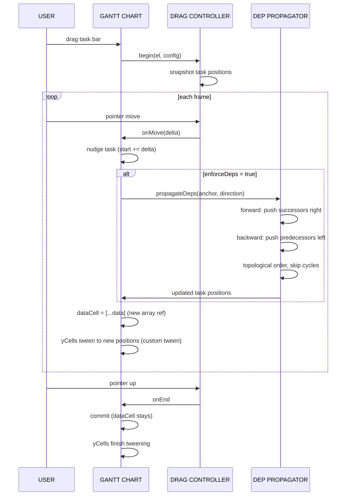

**Gantt is special:** it has its own tween system (per-task `yCell` num
cells with RAF-based interpolation) because y-position changes need to
animate smoothly during reorder, and `transitionOnUpdated` conflicts with
the JS tween. It also has bidirectional dependency propagation — dragging
one task pushes successors/predecessors in topological order.

### 6g. Drill (click to zoom into subtree)

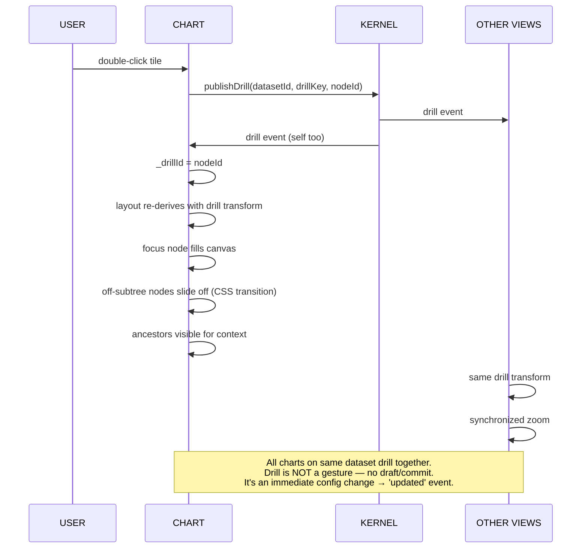

**Drill is not a gesture.** It's an immediate config change that triggers
an `updated` event. The layout re-derives with a transform that scales
the focus node to fill the canvas. Off-subtree nodes slide off via CSS
transitions (icicle) or collapse to zero-width (sunburst). All charts on
the same dataset drill together via the kernel's drill channel.

---

## 7. The modalities — every toggle, every variant

### 7a. Data shape

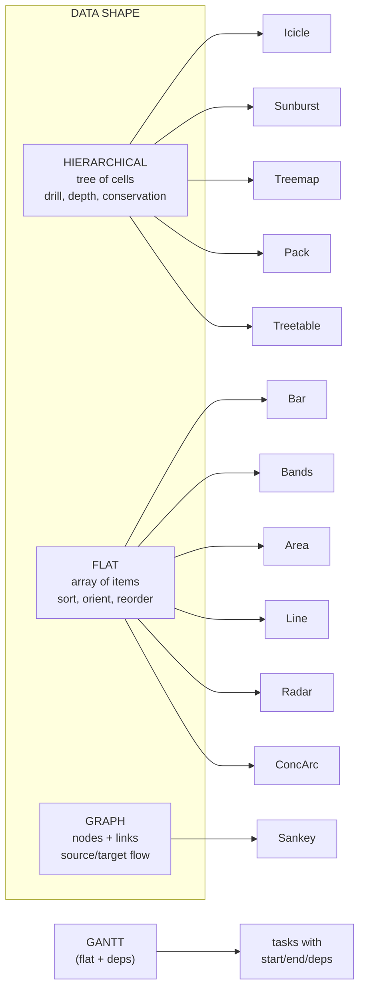

### 7b. Edit intent

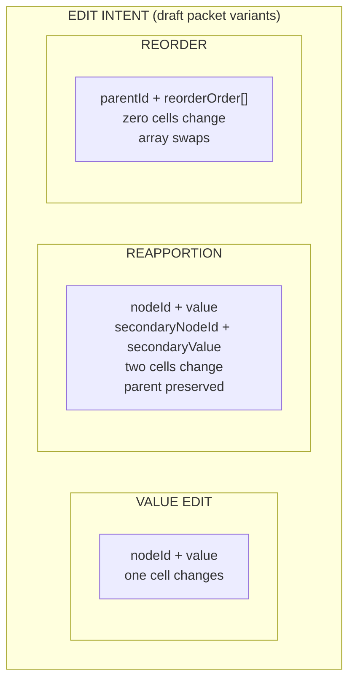

### 7c. Conservation mode

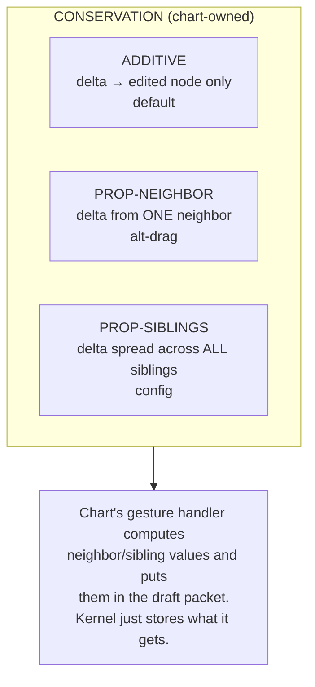

### 7d. Ghost resize (treemap only)

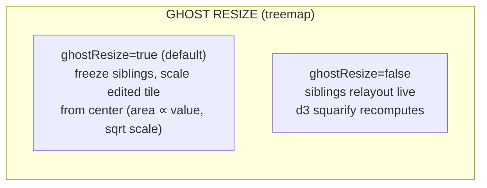

### 7e. Sort behavior

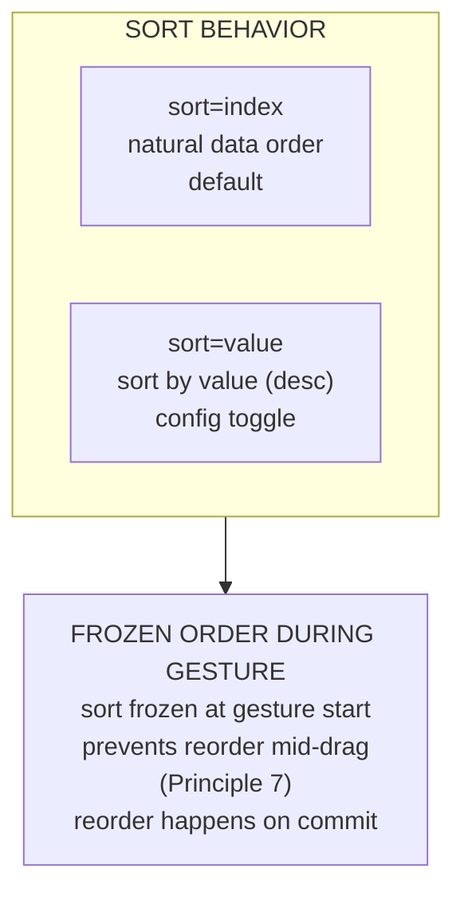

### 7f. Drill state

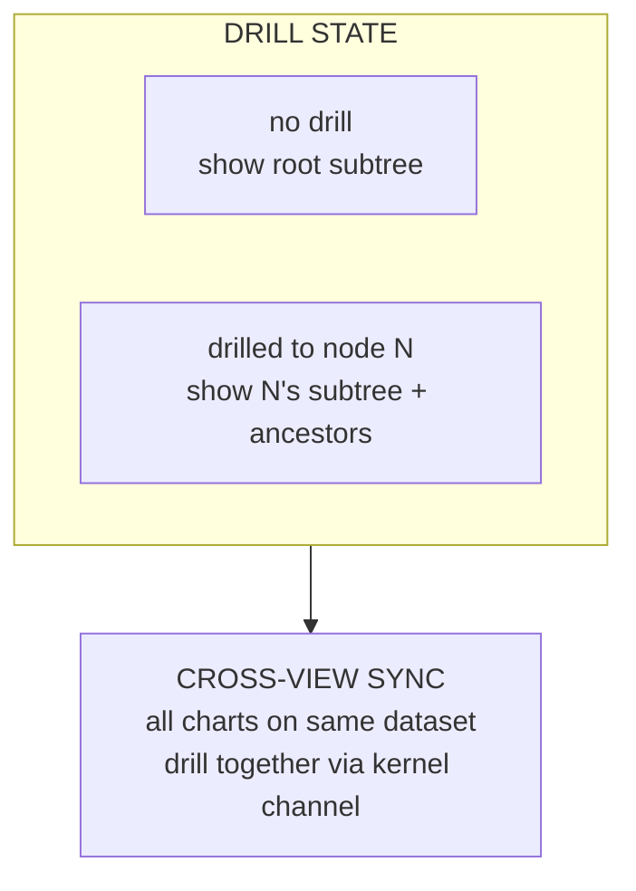

### 7g. Drag behavior

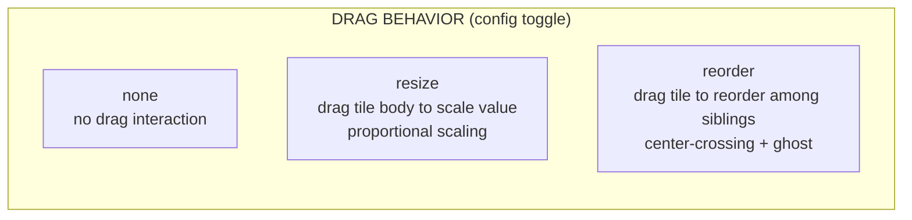

### 7h. Orientation (icicle, bar, bands)

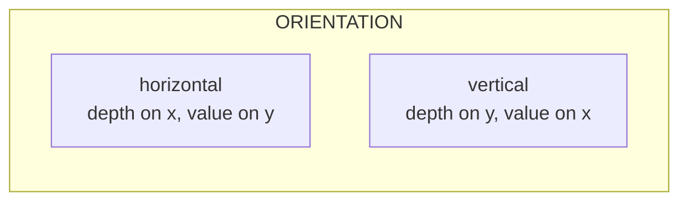

### 7i. Color mode

```mermaid
graph LR
    subgraph Color["COLOR MODE"]
        direction TB
        Flat["flat<br/>each node its own color"]
        Depth["depth<br/>color by depth level"]
        Mono["mono<br/>single color, shade by depth"]
    end
```

### 7j. Label mode + value mode (bar)

```mermaid
graph LR
    subgraph Label["LABEL MODE (bar)"]
        direction TB
        LNone["none"]
        LInside["inside<br/>label inside bar"]
        LOutside["outside<br/>label outside bar"]
    end

    subgraph Value["VALUE MODE (bar)"]
        direction TB
        VNone["none"]
        VInside["inside"]
        VOutside["outside"]
    end
```

### 7k. Connection topology (how charts connect to data)

```mermaid
graph TB
    subgraph TopA["VARIANT A: hierarchical (target — unified cells)"]
        direction LR
        A1["Reservoir"] -->|"one cell"| A2["Kernel (cells)"]
        A2 -->|"one cell"| A3["View (derive)"]
        A3 --> A4["Chart"]
    end

    subgraph TopB["VARIANT B: Cartesian (already correct)"]
        direction LR
        B1["Reservoir"] -->|"one cell"| B2["Num.lens"]
        B2 --> B3["dataCell"]
        B3 --> B4["Chart"]
    end

    subgraph TopC["VARIANT C: treetable editing (target — unified)"]
        direction LR
        C1["treetable writes cell"] --> C2["SHARED CELL"]
        C2 --> C3["Kernel (reads)"]
        C2 --> C4["Chart (reads via Num.lens)"]
        C3 --> C5["Other views"]
    end

    subgraph TopD["VARIANT D: cross-view (two charts, one dataset)"]
        direction LR
        D1["Reservoir"] --> D2["Kernel (cells)"]
        D2 --> D3["View A (icicle)"]
        D2 --> D4["View B (sunburst)"]
        D3 -.->|"draft broadcast"| D4
    end
```

---

## 8. The geometry layer — how each chart maps cells to pixels

```mermaid
graph TB
    subgraph RectGeom["RECTILINEAR (icicle)"]
        direction TB
        R1["computeLayout<br/>depth bands on one axis<br/>value-proportional on other<br/>1D affine drill transform"]
        R2["makeTile<br/>reactive rect, reads layout cell<br/>inset for gap (motion.separation)"]
        R3["makeHandle<br/>reactive rect at tile edge<br/>gated by layoutTransitioning"]
        R4["labelWrap<br/>reactive text, clipped<br/>reads valueMap for live updates"]
        R1 --> R2 & R3 & R4
    end

    subgraph RadGeom["RADIAL (sunburst)"]
        direction TB
        Ra1["computeRadialLayout<br/>angular span by value<br/>radial bands by depth<br/>angular scaling + radial shift drill"]
        Ra2["makeArc<br/>per-arc num cells (la0,la1,lrIn,lrOut)<br/>CSS can't tween path d<br/>settleArcCells effect tweens cells"]
        Ra3["makeAngularHandle<br/>reads same cells as arc<br/>stays in sync during transitions"]
        Ra4["labelWrapRadial<br/>rotate(mid) translate(r) rotate(flip)<br/>flip=180° when mid in (90°,270°)"]
        Ra1 --> Ra2 & Ra3 & Ra4
    end

    subgraph TMGeom["TREEMAP"]
        direction TB
        T1["computeTreemapLayout<br/>d3 squarify on FULL root<br/>2D affine drill transform<br/>padding reclaim for headers"]
        T2["makeTreemapTile<br/>group=frame (header+border)<br/>leaf=solid fill<br/>ghost resize: freeze + sqrt scale"]
        T1 --> T2
    end

    subgraph CartGeom["CARTESIAN (bar/bands/area/line)"]
        direction TB
        C1["band scale (category axis)<br/>value scale (linear)"]
        C2["forEach over data<br/>bar rect reads scales<br/>label reads valueMap"]
        C3["drag handle at value-end<br/>circle, visible on hover/focus"]
        C1 --> C2 & C3
    end

    subgraph Radial2["RADIAL FLAT (radar/conc-arc)"]
        direction TB
        Ra1b["radar: spoke per item<br/>per-slot radius cells<br/>two-lane gate: structural tween<br/>vs value snap"]
        Ra2b["conc-arc: ring per item<br/>drag handle on ring"]
    end
```

**Key geometry insight:** the sunburst can't use CSS transitions on path
`d` (Firefox falls back to a step), so it uses per-arc `num()` cells that
a JS settle effect tweens. The icicle CAN use CSS transitions on rect
`x/y/width/height` (modern browsers animate SVG geometry attributes as
CSS properties). The treemap uses CSS transitions on rects too. The
radar uses a two-lane gate: structural changes (sort, measure swap) tween
via `anim.start(tween(...))`, while value edits snap directly — because
value edits are reactive (the user is dragging) and shouldn't tween.

---

## 9. The transition system — three strategies

```mermaid
graph TB
    subgraph Strategies["TRANSITION STRATEGIES"]
        direction LR
        subgraph CSS["CSS TRANSITIONS (icicle, treemap, bar, bands)"]
            direction TB
            CSS1["transition-on-updated behavior"]
            CSS2["settleTransition(['x','y','width','height','fill'])"]
            CSS3["gesture-active class suppresses during drag"]
            CSS4["prefers-reduced-motion → transition:none"]
            CSS5["interruptible by construction"]
        end

        subgraph JS["JS TWEEN CELLS (sunburst, radar, gantt)"]
            direction TB
            JS1["per-element num() cells"]
            JS2["RAF loop interpolates cell values"]
            JS3["interruptible: retarget from current value"]
            JS4["used when CSS can't tween the property"]
            JS5["sunburst: path d. radar: structural vs value. gantt: y-position."]
        end

        subgraph CSSWrap["CSS TRANSFORM (bar/bands labels, reorder ghosts)"]
            direction TB
            CW1["wrap label in SVG g element"]
            CW2["position via transform: translate()"]
            CW3["CSS can tween transform"]
            CW4["used for labels that must slide with bars during reorder"]
        end
    end
```

**Why three strategies:** CSS transitions are the default (zero per-frame
cost, interruptible by construction, reduced-motion for free). JS tween
cells are used when CSS can't tween the property (SVG path `d`, or when
the chart needs programmatic control of the easing curve). CSS transform
is used for labels that need to slide with their parent shape during
reorder — SVG `<text>` `x`/`y` attributes aren't CSS-animatable, but
`transform: translate()` is.

**The `transition-on-updated` behavior** is the single owner of the
gesture-suppression contract. On draft → add `gesture-active` class
(suppresses transitions). On commit/cancel → remove class (transitions
fire for the settle). This ensures reactive feedback during the gesture
(Principle 3) and autonomous transition after commit (Principle 8).

---

## 10. Cross-view synchronization

```mermaid
sequenceDiagram
    participant A as CHART A (icicle)
    participant EA as EDITOR A
    participant K as KERNEL
    participant D as KERNEL.DRAFTS
    participant EB as EDITOR B
    participant B as CHART B (sunburst)
    participant EC as EDITOR C
    participant C as CHART C (treetable)

    Note over A,C: GLOBAL STATE: all editors registered with Kernel.Drafts

    A->>EA: draft (user drags handle)
    EA->>EA: Idle → Drafting
    EA->>D: onDraftStart(editorA)
    D->>D: activeEditor = A, isDrafting = true

    EA->>K: broadcastDraft(draft, "draft")
    K->>EB: draft event (B is not active)
    K->>EC: draft event (C is not active)

    Note over EB: editor.state = Idle (not Drafting)<br/>so it accepts the draft
    EB->>B: applyDraft — patch 1-2 cells
    EC->>C: applyDraft — patch 1-2 cells

    Note over B,C: live preview on all views

    A->>EA: commit
    EA->>EA: Drafting → Idle
    EA->>D: onDraftEnd(editorA)
    D->>D: activeEditor = null, isDrafting = false

    EA->>K: writeValue (ONE cell — target)
    K-->>B: cell changed (bireactive)
    K-->>C: cell changed (bireactive)

    EA->>K: broadcastCommit
    K->>EB: commit event
    K->>EC: commit event
    EB->>B: clear draft overlay
    EC->>C: clear draft overlay

    Note over B,C: CSS transition settles to committed value
```

**The broadcast contract:**
- `broadcastDraft` → all DataViews except the active editor. They
  `applyDraft` (patch cells in place) for live preview.
- `broadcastCommit` → all DataViews. They clear the draft overlay and
  let the committed value settle via CSS transition.
- `broadcastCancel` → all DataViews. They restore from snapshot.

**The `Kernel.Drafts` global state:** tracks which editor is active. If
chart B tries to start a gesture while chart A is drafting, the Drafts
state prevents it (one gesture, one user). This is the global mutex.

---

## 11. The bridge layer — compatibility + sync

```mermaid
graph TB
    subgraph Bridge["BRIDGE LAYER"]
        direction LR
        subgraph BiAdapt["bi-adapter"]
            direction TB
            BA1["adoptBiRoot — creates Kernel dataset from BiNode"]
            BA2["two-way leaf sync (target: eliminate)"]
            BA3["withBiCompat mixin — legacy prop facade"]
            BA4["maps maxDepth/sortBy/orientation/canReorder/<br/>conservationMode/showBreadcrumb/showRoot/<br/>colorMode/dragBehavior/exitFade → ChartConfig"]
        end

        subgraph HUD["hud-bridge"]
            direction TB
            H1["makeBridge — hover/selection sync"]
            H2["BrSyncBridge — connects chart to HUD overlay"]
            H3["hover cell → bridge → HUD highlights"]
            H4["selection cell → bridge → HUD selection"]
        end

        subgraph ST["side-table"]
            direction TB
            ST1["treetable sharing Kernel with icicle"]
            ST2["all cells editable (not just leaves)"]
            ST3["parent edit → distribute delta to leaves proportionally"]
            ST4["drill sync via kernel.subscribeDrill"]
        end
    end

    BiAdapt -.->|"compat"| Charts["Hierarchical Charts"]
    HUD -.->|"sync"| Charts
    ST -.->|"shares kernel"| Charts
```

**The bi-adapter is the thickest bridge.** It exists because the
hierarchical charts expect a Kernel dataset (DataNode tree) but the demos
app provides a BiNode tree (the Reservoir). The adapter:
1. Copies the BiNode tree into a DataNode tree (snapshot, non-reactive)
2. Installs a two-way sync: BiNode leaf changes → Kernel, Kernel changes
   → BiNode cells
3. Maps legacy element props (maxDepth, sortBy, etc.) to ChartConfig

**Target:** eliminate the two-way sync. If the Kernel stores cells (or
if the BiNode tree IS the Kernel's dataset), the adapter becomes a
one-time init: adopt the BiNode root, register it, done. No ongoing sync,
no `applying` guard, no echo loop risk.

---

## 12. The data models — how charts get fed

```mermaid
graph TB
    subgraph DemosApp["DEMOS APP"]
        direction TB
        Fixtures["fixtures<br/>(raw data arrays)"]
        DataModels["data-models.ts<br/>(per chart family)"]
        Main["main.ts<br/>(wires data models to charts)"]
    end

    subgraph DataFlow["DATA FLOW"]
        direction TB
        DM1["dataModelFor(id)"]
        DM2["model.setChartData(el)"]
        DM3["el.externalRoot = BiNode tree (hierarchical)"]
        DM4["el.externalData = flat array (Cartesian)"]
        DM5["el.dataCell = reactive cell (set by chart)"]
    end

    subgraph ChartIntake["CHART INTAKE"]
        direction LR
        Hier["hierarchical chart<br/>externalRoot → adoptBiRoot<br/>→ Kernel dataset"]
        Cart["Cartesian chart<br/>externalData → dataCell<br/>→ direct cell writes"]
    end

    Fixtures --> DataModels
    DataModels --> Main
    Main --> DM1
    DM1 --> DM2
    DM2 --> DM3 & DM4
    DM3 --> Hier
    DM4 --> Cart
    DM5 --> Cart
```

**Two intake paths:**
- **Hierarchical:** `externalRoot` (BiNode tree) → `adoptBiRoot` → Kernel
  dataset → DataView → Rebuilder → ChartNode tree → chart renders
- **Cartesian:** `externalData` (flat array) → `dataCell` → chart renders
  directly (no kernel, no DataView, no rebuild)

**The data models build the BiNode reservoir** with `num()` cells and
`Num.lens` derives. For hierarchical charts, the reservoir is adopted
into the Kernel. For Cartesian charts, the reservoir's leaf cells connect
to the chart's `dataCell` via `Num.lens` — direct cell propagation, no
copy.

---

## 13. What's right and what's wrong

### What's right (keep these)

```mermaid
graph TB
    subgraph Right["WHAT'S RIGHT"]
        direction TB
        R1["Behavior composition<br/>toggleable, composable, single responsibility"]
        R2["Editor state machine<br/>universal draft/commit/cancel across all charts"]
        R3["Gesture singleton<br/>one pointer, one gesture, one active editor"]
        R4["CSS transitions for settle<br/>zero per-frame cost, interruptible, reduced-motion"]
        R5["Cartesian reactivity model<br/>direct cell writes, O(1), fine-grained"]
        R6["Cross-view draft broadcast<br/>live preview on all views, O(1) cell patches"]
        R7["Drill channel<br/>synchronized zoom across views"]
        R8["Frozen order during gesture<br/>prevents reorder mid-drag (Principle 7)"]
        R9["Per-arc cells for sunburst<br/>JS tween where CSS can't tween path d"]
        R10["Two-lane gate for radar<br/>structural tween vs value snap"]
        R11["Gantt dependency propagation<br/>bidirectional, topological, real-time"]
    end
```

### What's wrong (fix these)

```mermaid
graph TB
    subgraph Wrong["WHAT'S WRONG"]
        direction TB
        W1["Kernel bulk-write<br/>leafValues + writeValues(ALL leaves)<br/>should be: writeValue(ONE cell)"]
        W2["Rebuilder on every commit<br/>buildTree walks entire tree, fresh cells<br/>should be: one-time construction, cells persist"]
        W3["DataNode.value is plain number<br/>not reactive, requires recomputeSums walk<br/>should be: Writable<number> cell, parents derive"]
        W4["bi-adapter two-way sync<br/>echo guard, dual-tree redundancy<br/>should be: BiNode tree IS the dataset"]
        W5["Treetable dual-write<br/>writes ChartNode cell AND BiNode cell<br/>should be: one cell, one write, N readers"]
        W6["_publish fan-out<br/>notifies ALL subscribers, each rebuilds<br/>should be: cell change propagates via bireactive"]
        W7["Two reactivity models<br/>hierarchical (kernel) vs Cartesian (cells)<br/>should be: one model, cells everywhere"]
    end

    style Wrong fill:#3a1a1a,color:#fff
```

### The fix pattern (applies to all of the above)

```mermaid
graph LR
    subgraph Current["CURRENT (broken)"]
        direction TB
        C1["commit"] --> C2["collect ALL leaves"]
        C2 --> C3["write ALL to kernel"]
        C3 --> C4["publish to ALL"]
        C4 --> C5["rebuild EVERYTHING"]
    end

    subgraph Target["TARGET"]
        direction TB
        T1["commit"] --> T2["write ONE cell"]
        T2 --> T3["bireactive propagates"]
        T3 --> T4["only dependents re-run"]
        T4 --> T5["CSS transition settles"]
    end

    style Current fill:#3a1a1a,color:#fff
    style Target fill:#1a3a1a,color:#fff
```

**The unifying principle:** the BiNode reservoir already has cells. The
Cartesian charts already use those cells directly. The hierarchical charts
should too. The Kernel should store cells (or reference the BiNode cells
directly). The Rebuilder should be retired. The bi-adapter should become
a one-time init. One reactivity model, one cell propagation path, O(1)
per edit everywhere.

---

## 14. The architecture we're building toward

```mermaid
graph TB
    subgraph Target["TARGET ARCHITECTURE"]
        direction TB
        subgraph Source["SOURCE OF TRUTH"]
            Reservoir["Reservoir<br/>(BiNode tree — cells)<br/>leaf total cells +<br/>group Num.lens derives"]
        end

        subgraph Kernel["KERNEL (cell-aware)"]
            direction TB
            K1["stores cell references<br/>(not copies of plain numbers)"]
            K2["writeValue = set one cell"]
            K3["writeReorder = swap child array"]
            K4["broadcastDraft = fan-out to views"]
            K5["NO _publish — bireactive propagates"]
            K6["NO recomputeSums — parents derive"]
        end

        subgraph Views["VIEWS"]
            direction LR
            V1["DataView A<br/>derives from cells"]
            V2["DataView B<br/>derives from cells"]
            V3["DataView C<br/>derives from cells"]
        end

        subgraph Charts["CHARTS"]
            direction LR
            Ch1["Icicle<br/>renders from cells"]
            Ch2["Sunburst<br/>renders from cells"]
            Ch3["Bar<br/>renders from cells"]
            Ch4["Treetable<br/>writes to cells"]
        end

        Reservoir -->|"cells (shared)"| Kernel
        Kernel --> V1 & V2 & V3
        V1 --> Ch1
        V2 --> Ch2
        V3 --> Ch4
        Ch3 -.->|"reads cells directly"| Reservoir

        Note["NO Rebuilder. NO Snapshot Tank.<br/>NO bi-adapter two-way sync.<br/>NO leafValues. NO buildTree on commit.<br/>One cell, one write, N readers."]
    end

    style Target fill:#1a3a1a,color:#fff
```

**This is the full Y view.** Every chart family, every gesture type,
every modality, the reactivity model, the draft/commit/cancel lifecycle,
cross-view sync, drill, reorder, conservation, ghost resize, the
transition strategies, the bridge layer, the data models — all connected
by one principle: **fine-grained cell reactivity, O(1) per edit, no
rebuilds.**

The mechanisms we have are mostly right. The behavior composition, the
Editor state machine, the gesture singleton, the CSS transition strategy,
the cross-view draft broadcast, the drill channel, the frozen order
pattern, the per-arc cells, the two-lane gate, the gantt dependency
propagation — all of these are sound. The problem is narrow: the Kernel's
data layer is non-reactive (plain numbers instead of cells), and the
Rebuilder compensates by rebuilding everything on every commit. Fix the
data layer and the rest of the architecture falls into place.
