# 2026-08-02 — Plumbing: change packets through the reactor

Diagrams of how value-change packets flow. The target architecture, not
the current broken one. Current breakage cited only as contrast.

---

## The machines

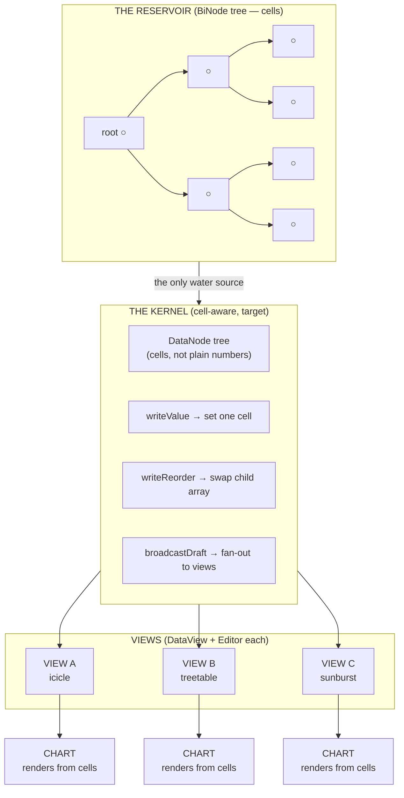

**Key principle:** the Kernel stores cells. Charts derive from cells.
No rebuild step. No "collect all leaves and republish." A write is O(1).
A subscriber notification is "this cell changed" — bireactive tracks the
rest.

---

## Flow 1 — single value edit (the happy path)

User drags an icicle edge handle. One leaf changes.

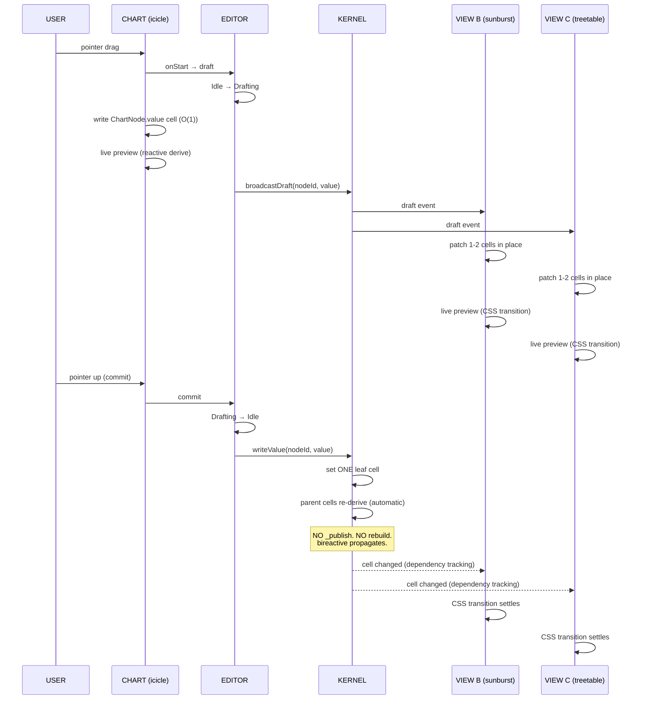

**Packet size:** one cell write. One broadcast. N views each patch 1-2
cells in place. Zero tree walks. Zero rebuilds.

> **What we're fixing:** today this flow collects ALL leaves, writes them
> all to the kernel, publishes to all subscribers, and each subscriber
> rebuilds the entire ChartNode tree from scratch. O(N) per edit.

---

## Flow 2 — two-sibling reapportion (edge handle drag)

User drags a boundary between two siblings. Both change, parent sum
preserved.

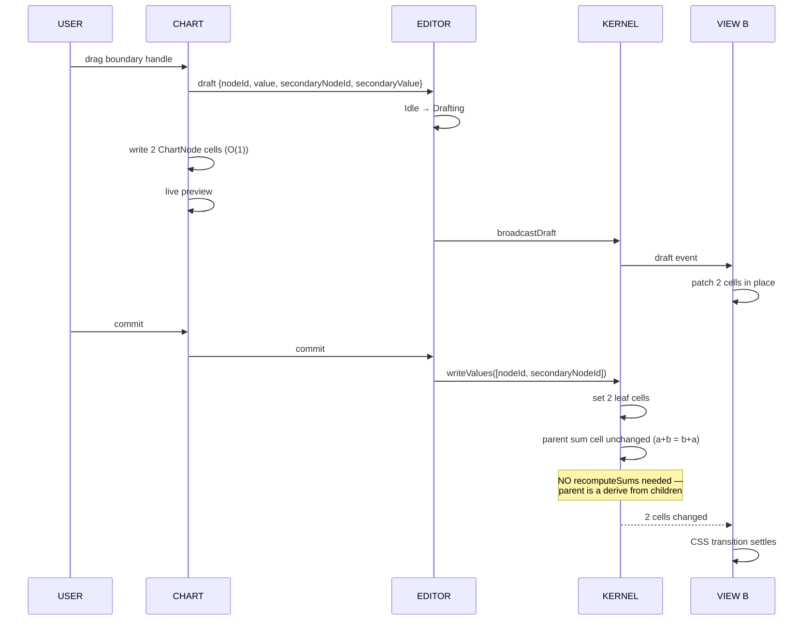

**Packet size:** two cell writes. Parent sum derives unchanged.

> **What we're fixing:** today `writeValues` writes ALL leaves, not just
> the changed pair. The original Jul 17 commit needed two-sibling atomic
> write but used a sledgehammer — write everything instead of just the
> pair.

---

## Flow 3 — reorder (drag to reorder, sort=index)

User drags a bar up to reorder. No values change — just child order.

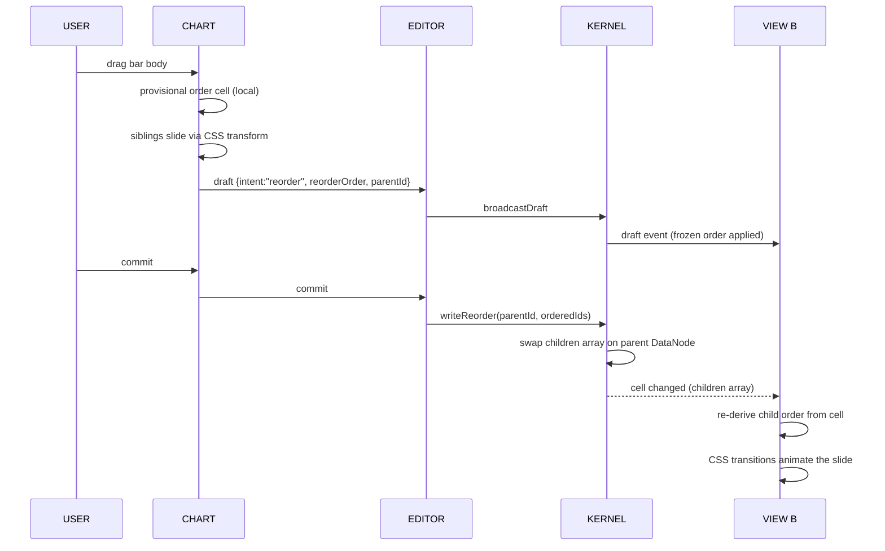

**Packet size:** one array swap on one node.

---

## Flow 4 — cross-view draft preview

Two charts share a dataset. Chart A starts a drag. Chart B sees the
preview live, then both settle on commit.

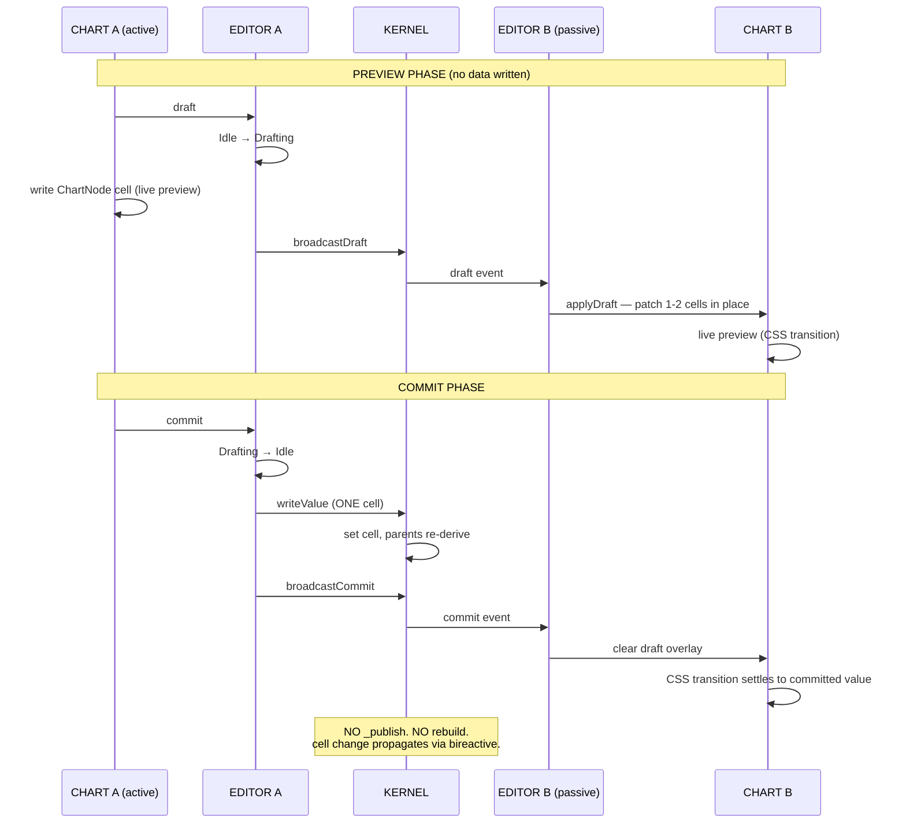

> **What we're fixing:** today the commit path calls `leafValues(root)` →
> `kernel.writeValues(allLeaves)` → `_publish` → each view calls
> `buildWindow()` (full tree walk) → `buildTree()` (full tree walk, fresh
> cells). Preview is O(1) but commit is O(N). Target: commit is also O(1).

---

## Flow 5 — Cartesian chart (no kernel)

Bar/bands/radar/concentric arc/gantt. These never touch the kernel.

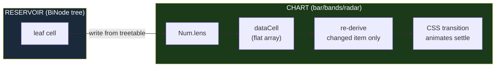

**This is the model the kernel should follow.** One cell write →
bireactive tracks dependencies → only affected derives re-run → CSS
transitions animate. O(1) per edit. No tree walks, no rebuilds, no
publish fan-out.

---

## Flow 6 — treetable edit (target: unified)

In the target architecture, the treetable writes to the same cells the
chart reads from. No dual-write hack.

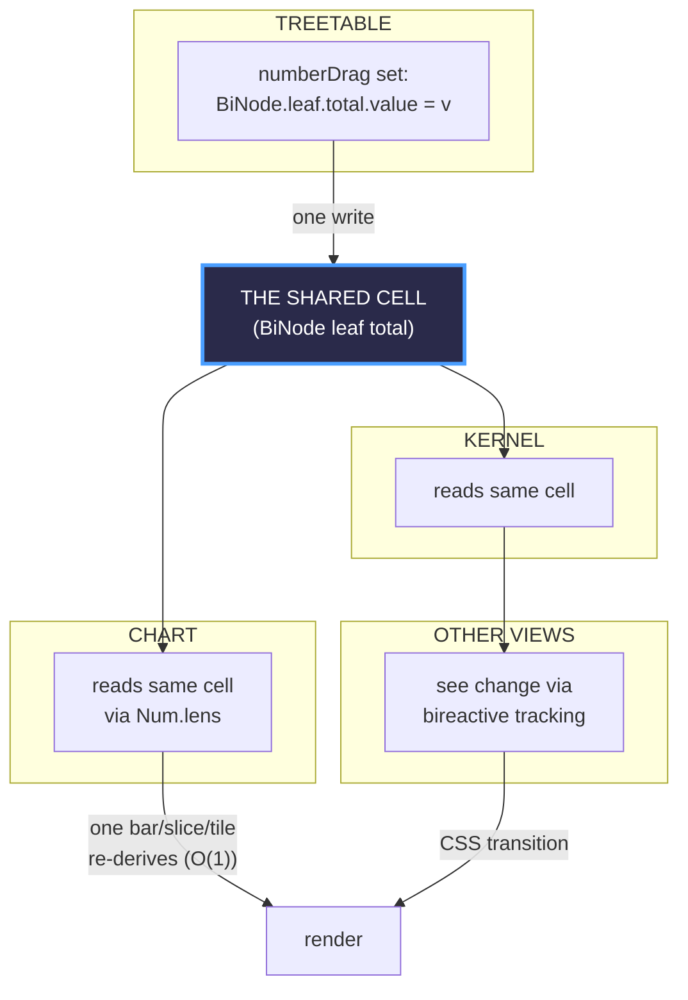

**One cell, one write, N readers.** No "primary column routes through
kernel, extra columns write BiNode directly." No dual-write. No
workaround. The cell IS the truth — everyone reads from it.

> **What we're fixing:** today the treetable writes to BOTH a ChartNode
> cell (for the kernel draft flow) AND a BiNode cell (for Cartesian
> charts). Two writes to two different trees for the same logical edit.

---

## The modalities (optionality)

### Edit intent variants

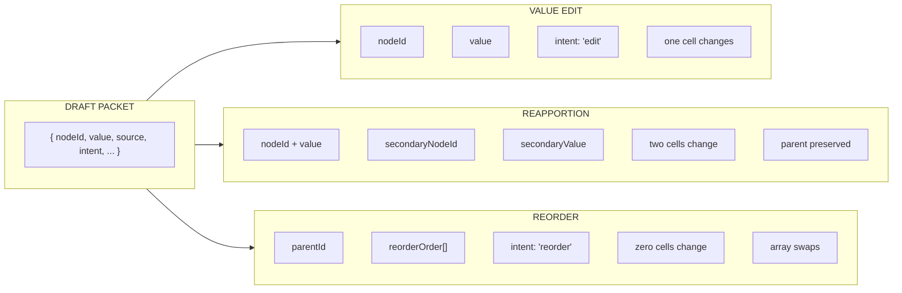

### Conservation mode variants (hierarchical only)

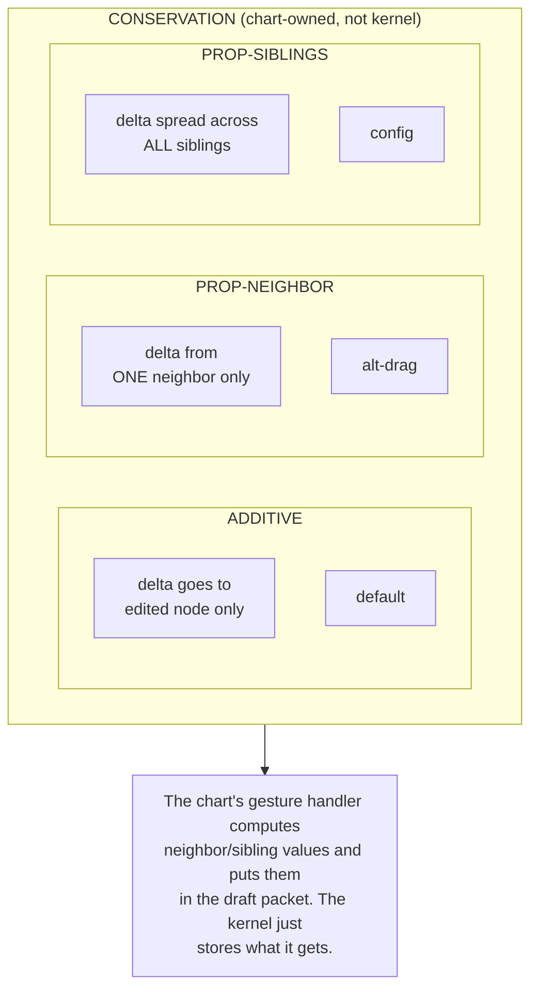

### Data shape variants

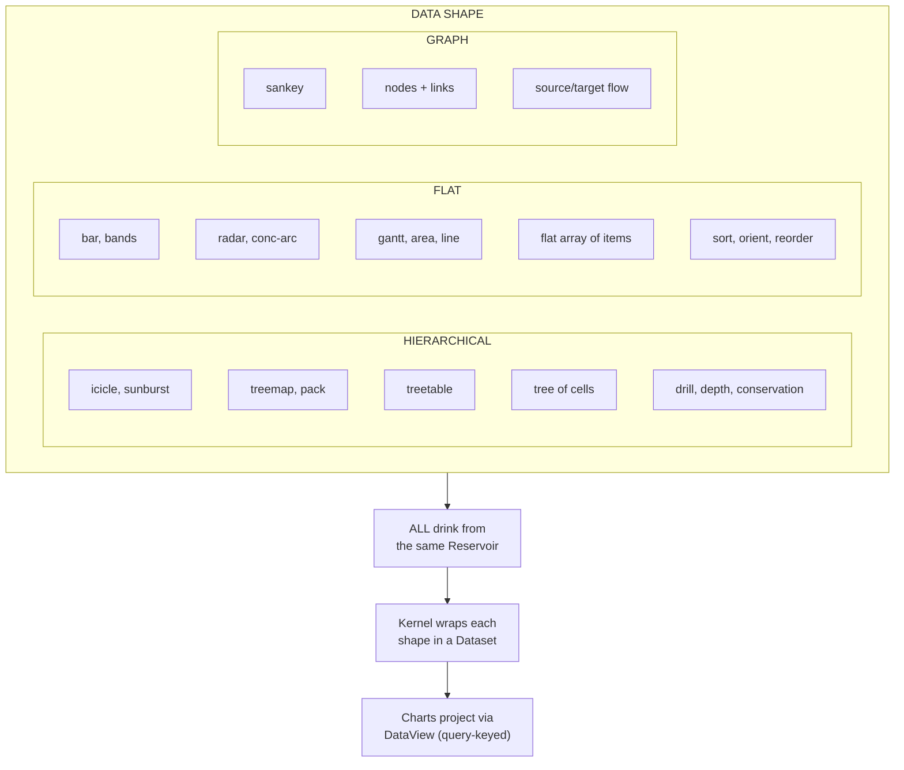

### Connection topology variants

```mermaid
graph TB
    subgraph VA["VARIANT A: hierarchical chart (target)"]
        direction LR
        RA1["Reservoir<br/>(BiNode)"] -->|"one cell"| KA1["Kernel<br/>(cells)"]
        KA1 -->|"one cell"| VIA1["View<br/>(derive)"]
        VIA1 -->|"one rect"| CA1["Chart<br/>(renders)"]
    end

    subgraph VB["VARIANT B: Cartesian chart (already correct)"]
        direction LR
        RB1["Reservoir<br/>(BiNode)"] -->|"one cell"| NB1["Num.lens"]
        NB1 -->|"one bar"| CB1["Chart<br/>(renders)"]
    end

    subgraph VC["VARIANT C: treetable editing (target)"]
        direction LR
        TC1["treetable<br/>writes cell"] --> SC1["SHARED CELL<br/>(BiNode leaf total)"]
        SC1 --> KC1["Kernel<br/>(reads cell)"]
        SC1 --> CC1["Chart<br/>(reads cell)"]
        KC1 --> VC1["Other views<br/>(derive)"]
    end

    subgraph VD["VARIANT D: cross-view (two charts, one dataset)"]
        direction LR
        RD1["Reservoir"] --> KD1["Kernel<br/>(cells)"]
        KD1 --> VDA["View A<br/>icicle"]
        KD1 --> VDB["View B<br/>sunburst"]
        VDA -.->|"draft broadcast"| VDB
    end
```

---

## What we're fixing (the broken pipe)

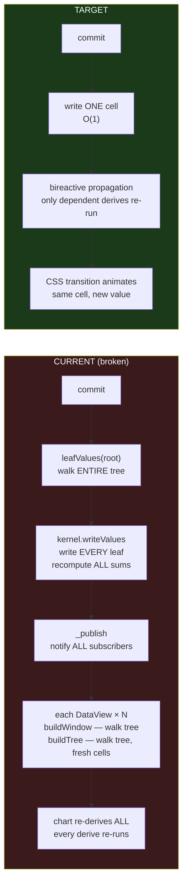

The difference: **one cell write vs entire tree rebuild.** The Reservoir
already has cells. The Kernel should too. Then the Rebuilder, the
Snapshot Tank, and the Adapter all become unnecessary — there's one
reactive tree, everyone reads from the same cells, and bireactive tracks
the dependencies.
