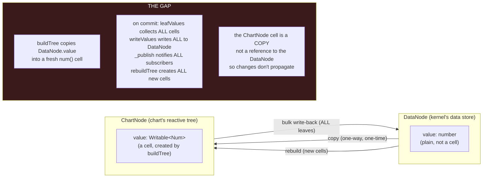
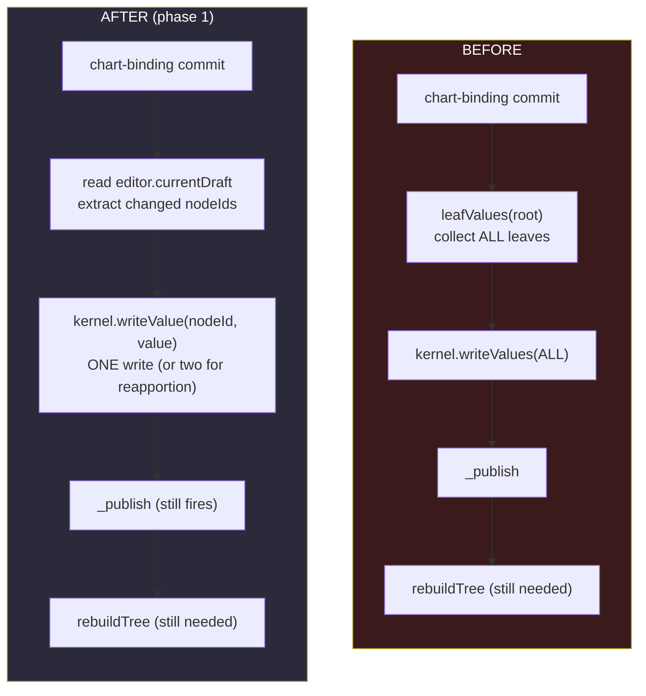
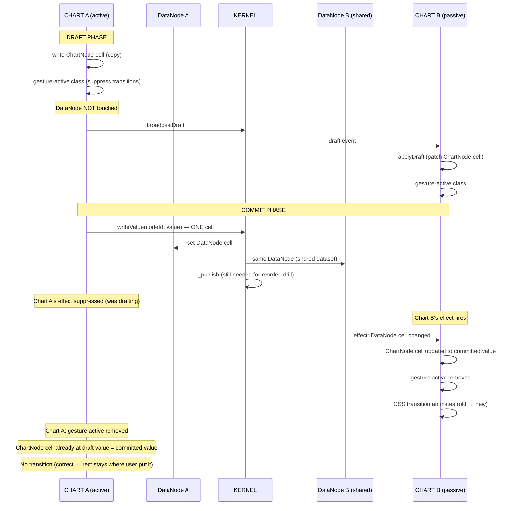
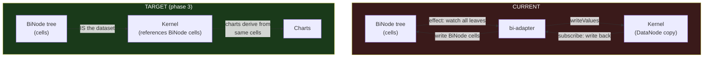
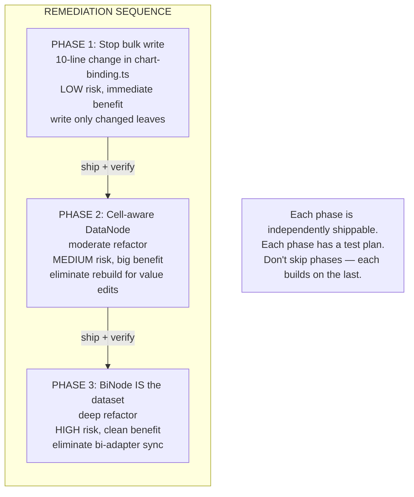

# 2026-08-02 — Remediation: making the kernel reactive

What it takes to fix the non-reactive kernel, what could break, and what
we'd lose. Honest assessment — this is a real refactor with real risks,
not a mechanical change.

---

## The core problem, precisely



The `DataNode.value` is a plain `number`. The `ChartNode.value` is a
`Writable<Num>` cell created by `buildTree`. The cell is a **copy** —
initialized from the number, not a reference to it. There's no reactive
connection between them. To propagate a change from DataNode to ChartNode,
you must rebuild the entire ChartNode tree. To propagate from ChartNode
to DataNode, you must collect all leaf values and write them back.

The `buildTree` function (`tree.ts` line 79-92):

```typescript
export function buildTree(root: DataNode, ...): ChartNode {
  const children = root.children.map((c) => buildTree(c, ...));
  const value = children.length === 0
    ? num(root.value)           // ← fresh cell from plain number
    : total(children.map(c => c.value));  // ← fresh derive over new cells
  return { id, label, color, value, children, parent };
}
```

Every `buildTree` call creates **new cells**. The old cells (and their
CSS transition state) are discarded. This is why the kernel triggers a
full rebuild on every commit — there's no other way to get the DataNode
values into the ChartNode cells.

---

## Why it happened (the honest answer)

The icicle-harness (Jul 16) was a **standalone prototype**. It wasn't
inside the bireactive package. The design doc said "no bireactive in the
domain model" — `types.ts` line 2: "No bireactive here. These are the
domain model." That made sense for a framework-agnostic prototype.

Two days later (Jul 18, `b65d5db8`), the harness was ported **verbatim**
into `@hotbook/bireactive` — a package literally named bireactive. The
"no bireactive in the domain model" principle was no longer relevant,
but nobody updated the DataNode type. The non-reactive `number` field
survived because it worked, and the Rebuilder compensated.

The Cartesian charts (Jul 21, `24a0f1ba`) were built fresh on
`CartesianChartBase`, which uses `dataCell` (a reactive cell) directly.
They never had this problem. The split between "hierarchical charts with
kernel" and "Cartesian charts with cells" was born.

---

## What remediation looks like — three phases

### Phase 1: Stop writing ALL leaves (trivial, low risk)



**Change:** in `chart-binding.ts`, instead of `leafValues(root)` →
`writeValues(all)`, read `editor.currentDraft` and write only the changed
node(s). The draft already carries `nodeId`, `value`,
`secondaryNodeId`, `secondaryValue`.

**What this fixes:** the O(N) leaf collection + O(N) write becomes O(1).
The `_publish` and `rebuildTree` still happen, but the write itself is
cheap.

**What could break:**
- If the draft has `intent: "reorder"` (no value change), we should skip
  the value write entirely. Currently `leafValues` writes all leaves even
  for reorders — which is wasteful but harmless. The fix must handle this
  case.
- If a behavior writes to ChartNode cells WITHOUT going through the
  draft (e.g. the treetable's `_distributeDelta` writes to multiple
  leaves), the draft only carries the primary nodeId. The other changed
  leaves would be lost. Need to check: does the treetable's parent-edit
  distribution go through the draft, or does it write cells directly?

**Risk: LOW.** This is a 10-line change in `chart-binding.ts`. The
rebuild still happens, so the chart still gets the correct values. The
only difference is the kernel write is smaller.

### Phase 2: Make DataNode.value a cell (moderate, medium risk)

```mermaid
graph TB
    subgraph Change["THE CHANGE"]
        direction TB
        C1["DataNode.value: number → Writable&lt;Num&gt;"]
        C2["registerDataset: initialize cells from BiNode leaves"]
        C3["recomputeSums → eliminated (parents use total())"]
        C4["writeValue: node.value = v → node.value.value = v"]
        C5["buildTree: num(root.value) → root.value (use cell directly)"]
        C6["buildWindow: node.value → node.value.value (read cell)"]
    end

    subgraph StillNeeded["STILL NEEDED"]
        direction TB
        S1["_publish → still fires (for reorder sync)"]
        S2["rebuildTree → still needed for reorders"]
        S3["snapshot/restore → still needed for cancel"]
        S4["applyDraft → still patches ChartNode cells"]
    end

    subgraph Eliminated["ELIMINATED"]
        direction TB
        E1["recomputeSums — parents derive via total()"]
        E2["leafValues — no longer collecting ALL leaves"]
    end
```



**Change:** `DataNode.value` becomes `Writable<Num>`. The kernel stores
cells, not plain numbers. `buildTree` references the DataNode's cell
directly instead of creating a copy.

**The critical subtlety:** `buildTree` currently creates `num(root.value)`
— a **copy**. If we change it to use `root.value` directly (the same
cell reference), then draft writes to ChartNode cells would immediately
affect the DataNode. That's wrong — drafts are speculative.

**The fix:** `buildTree` still creates a `num()` copy for leaves. But
install an **effect** that syncs DataNode cell → ChartNode cell when the
DataNode changes (and the chart is NOT drafting). This gives us:
- Draft writes go to the ChartNode copy (independent)
- On commit, the kernel writes to the DataNode cell
- The effect fires on all views, updating their ChartNode copies
- CSS transitions animate the change (cell value changes from old to new)



**What this fixes:** cross-view sync is O(1) — one cell write, one effect
per view. No `rebuildTree` for value edits. No `leafValues`. No
`recomputeSums`. The ChartNode tree persists across commits (cells keep
their identity, CSS transitions work).

**What could break:**
1. **The effect suppression during draft:** if the effect fires while
   the chart is drafting (e.g. another chart commits a value), the
   draft values would be overwritten. Need to suppress the effect when
   `editor.state === "Drafting"`. But we still want cross-view drafts to
   apply — `applyDraft` patches the ChartNode cell directly, bypassing
   the effect. This should work but needs testing.

2. **The `buildWindow` function:** reads `node.value` (plain number).
   Must change to `node.value.value` (cell read). This is used by
   `data-view.ts` for the rendered window. Mechanical change but touches
   a hot path.

3. **The bi-adapter two-way sync:** currently syncs BiNode ↔ DataNode.
   If DataNode values are cells, the sync becomes cell-to-cell. The
   `applying` guard is still needed (BiNode → DataNode → ChartNode →
   DataNode echo). But the sync is simpler: one effect per leaf, not a
   tree walk.

4. **The `total()` derive for group sums:** `buildTree` creates
   `total(children.map(c => c.value))` for groups. If the ChartNode
   cells are copies (not references to DataNode cells), the `total()`
   derives from the copies. When a copy changes (draft), the total
   re-derives. When the effect syncs DataNode → copy, the total
   re-derives again. This is correct but means the total derives twice
   on commit (once from the draft write, once from the sync). Need to
   verify this doesn't cause a visible flicker.

5. **Reorders still need a rebuild:** `writeReorder` swaps the DataNode
   children array. The ChartNode tree's children are copies (built once
   by `buildTree`). They don't reflect the new order. We still need
   `rebuildTree` for reorders — OR a targeted update that swaps the
   ChartNode children array to match. The rebuild for reorders is
   acceptable (reorders are infrequent, not per-frame).

6. **The `snapshotValues`/`restoreValues` functions:** these read/write
   ChartNode cell values. They still work — the cells are still
   `Writable<Num>`. No change needed.

7. **The `applyDraft` function:** patches ChartNode cells. Still works.
   No change needed.

**Risk: MEDIUM.** The change is conceptually clean but touches several
hot paths. The effect suppression logic is the trickiest part — getting
it wrong means either draft values get overwritten (bad) or cross-view
sync doesn't work (bad). Needs careful testing of: single-chart value
edit, cross-view value edit, cancel, reorder, drill, sort change.

### Phase 3: Eliminate the bi-adapter two-way sync (larger, higher risk)



**Change:** the BiNode tree IS the kernel's dataset. No DataNode copy, no
two-way sync, no `applying` guard. The kernel stores a reference to the
BiNode root. `buildTree` reads BiNode cells directly. Charts derive from
the same cells the BiNode tree owns.

**What this fixes:** eliminates the entire bi-adapter sync layer. One
tree, one set of cells, no copies, no echo guards. The `applying` flag
and the two `effect`/`subscribe` loops are gone.

**What could break:**
1. **The `DataNode` type is used throughout the hierarchical package.**
   Changing it to `BiNode` (or a cell-aware equivalent) touches every
   file that imports `DataNode`. This is a large mechanical change.

2. **The `buildWindow` function** walks the DataNode tree. If the tree
   is a BiNode tree, the walk is different (BiNode has `value.total`,
   `value.label`, `value.id`, `children` as a cell array, etc.).

3. **The `withBiCompat` mixin** maps legacy props to ChartConfig. It
   currently calls `adoptBiRoot` which creates a DataNode copy. Without
   the copy, it just passes the BiNode root to the kernel directly.

4. **The `sharedKernel`** currently creates a new dataset per BiNode
   root. Without copies, the kernel stores BiNode roots directly. The
   `registerDataset` function changes.

5. **Reorders:** the BiNode tree's `children` array is a plain array
   (not a cell). Swapping it requires the same mechanism as today —
   `writeReorder` swaps the array, `_publish` notifies, charts
   re-derive. Or we make the children array a cell.

6. **The `Num.lens` derives on BiNode groups** already compute parent
   sums. The kernel's `recomputeSums` is redundant. With the BiNode tree
   as the dataset, group sums derive automatically.

**Risk: HIGH.** This is a deep refactor that touches the type system,
the kernel, the adapter, and every chart that uses the kernel. It's the
right end state but it's a lot of surface area. Should be done last,
after phases 1 and 2 are stable.

---

## What you'd lose

```mermaid
graph TB
    subgraph Lost["WHAT YOU'D LOSE"]
        direction TB
        L1["Framework-agnostic DataNode<br/>'No bireactive in the domain model'<br/>— but the package IS bireactive. Moot."]
        L2["recomputeSums tree walk<br/>— replaced by total() derives. No loss."]
        L3["leafValues collection<br/>— replaced by targeted writes. No loss."]
        L4["_publish fan-out for value edits<br/>— replaced by cell propagation. No loss.<br/>_publish still needed for reorders + drill."]
        L5["bi-adapter two-way sync (phase 3)<br/>— replaced by direct cell sharing. No loss.<br/>The applying guard goes away. Good riddance."]
    end

    subgraph Kept["WHAT YOU KEEP"]
        direction TB
        K1["Editor state machine — unchanged"]
        K2["Gesture + behavior composition — unchanged"]
        K3["Draft/commit/cancel lifecycle — unchanged"]
        K4["broadcastDraft for cross-view preview — unchanged"]
        K5["applyDraft (patches ChartNode cells) — unchanged"]
        K6["snapshot/restore for cancel — unchanged"]
        K7["frozenOrder during gesture — unchanged"]
        K8["transition-on-updated (gesture-active class) — unchanged"]
        K9["CSS transitions on SVG geometry — unchanged"]
        K10["Per-arc cells for sunburst — unchanged"]
        K11["Two-lane gate for radar — unchanged"]
        K12["Gantt tween system — unchanged"]
        K13["Drill channel — unchanged"]
        K14["Kernel.Drafts global mutex — unchanged"]
    end

    style Lost fill:#2a2a3a,color:#fff
    style Kept fill:#1a3a1a,color:#fff
```



**You lose nothing of value.** The things being eliminated are:
- A plain-number field that should have been a cell from the start
- A tree walk that's redundant when cells derive automatically
- A bulk write that was a workaround for the non-reactive field
- A two-way sync that's redundant when there's one set of cells

The things being kept are the entire gesture/behavior/transition
architecture — which is the part that actually works well.

---

## What could regress (honest list)

```mermaid
graph TB
    subgraph Risks["REGRESSION RISKS BY PHASE"]
        direction TB

        subgraph P1["PHASE 1 (stop bulk write)"]
            direction TB
            R1a["Treetable parent-edit: _distributeDelta writes<br/>multiple leaves but draft only carries primary nodeId.<br/>FIX: collect all changed cells, not just draft nodeId."]
            R1b["Reorder commits: draft has intent='reorder',<br/>no value change. Must skip value write.<br/>FIX: check draft.intent before writing."]
        end

        subgraph P2["PHASE 2 (cell-aware DataNode)"]
            direction TB
            R2a["Effect suppression during draft:<br/>if another chart commits while this chart is drafting,<br/>the effect must NOT overwrite draft values.<br/>FIX: suppress effect when editor.state === Drafting."]
            R2b["Double-derive of total():<br/>draft write triggers derive, then sync triggers again.<br/>FIX: verify no visible flicker. May need batch()."]
            R2c["buildWindow reads node.value.value:<br/>mechanical change but hot path.<br/>FIX: test all chart families."]
            R2d["Reorders still need rebuild:<br/>ChartNode children are copies, don't reflect new order.<br/>FIX: keep rebuildTree for reorders only, or targeted swap."]
            R2e["bi-adapter sync becomes cell-to-cell:<br/>effect writes DataNode cell, adapter effect writes BiNode cell.<br/>Potential echo if guards misaligned.<br/>FIX: verify applying flag still works with cells."]
        end

        subgraph P3["PHASE 3 (BiNode IS the dataset)"]
            direction TB
            R3a["Every file importing DataNode changes.<br/>Large mechanical surface area."]
            R3b["buildWindow walks different tree shape.<br/>BiNode has value.total, not value."]
            R3c["withBiCompat mixin changes.<br/>adoptBiRoot becomes pass-through."]
            R3d["Reorders: BiNode children array is plain array.<br/>Same issue as phase 2."]
            R3e["Num.lens on BiNode groups already derives sums.<br/>Must not double-derive with total()."]
        end
    end

    style P1 fill:#1a3a1a,color:#fff
    style P2 fill:#2a2a3a,color:#fff
    style P3 fill:#3a1a1a,color:#fff
```



### The scariest risks (and how to de-risk them)

**1. Cross-view sync during simultaneous draft (phase 2)**

If chart A is drafting and chart B commits a value, chart A's effect
must not overwrite the draft values. The fix: suppress the effect when
`editor.state === "Drafting"`. But `applyDraft` (cross-view draft
preview) still patches cells directly — it bypasses the effect. This
should be safe, but it's the kind of thing that's easy to get wrong and
hard to test (requires two charts, simultaneous gestures).

**De-risk:** write a test with two charts on the same dataset. Start a
drag on chart A. While A is drafting, programmatically commit a value
change on chart B. Verify A's draft values are not overwritten.

**2. The treetable parent-edit distribution (phase 1)**

The treetable's `_distributeDelta` writes to multiple leaf cells when a
parent is edited. The draft only carries the parent nodeId. If phase 1
only writes the draft's nodeId to the kernel, the distributed leaf
changes are lost.

**De-risk:** before phase 1, check if the treetable's parent-edit goes
through the draft or writes cells directly. If it writes directly, the
`leafValues` approach is the only way to capture those changes — phase 1
needs to handle this case (e.g. diff the snapshot against current values
to find all changed leaves, not just the draft nodeId).

**3. Reorder + value edit interaction (phase 2)**

Reorders swap the children array. Value edits change cell values. If a
reorder and value edit happen in sequence (reorder commit, then value
edit), the rebuild from the reorder creates new cells, and the effect
sync from the value edit writes to the old cells. Order of operations
matters.

**De-risk:** keep `rebuildTree` for reorders. After a reorder rebuild,
the effect re-connects to the new cells. Value edits use the effect
(no rebuild). The two paths are separate and don't interfere.

**4. CSS transition continuity (phase 2)**

Currently, `rebuildTree` creates new cells. The old cells' transition
state is lost. With persistent cells (no rebuild), the cell identity
persists, and CSS transitions can track value changes across commits.
This is BETTER — but it means the transition behavior might change.
For example, a sort change currently rebuilds all cells (all rects
transition from old to new positions). With persistent cells, the
values change but the cell identity stays — the transition still fires
because the value changed. Should be fine, but needs visual verification.

**De-risk:** after phase 2, test: sort toggle, orientation toggle,
drill in/out, reorder commit, value edit commit, cancel. Verify
transitions animate correctly in all cases.

---

## Recommended approach



**Phase 1 first.** It's a 10-line change with low risk. It doesn't fix
the rebuild problem but it stops the O(N) write. Ship it, verify nothing
breaks, then move to phase 2.

**Phase 2 second.** This is the real fix — cell-aware DataNode, no
rebuild for value edits. Medium risk but high reward. Test thoroughly:
all gesture types, all chart families, cross-view sync, cancel, reorder,
drill, sort.

**Phase 3 last.** Eliminate the bi-adapter. This is the cleanest end
state but the highest risk. Only do this after phase 2 is stable and
well-tested. The benefit is code elimination (the entire sync layer
goes away), not performance.

**Between phases: verify, verify, verify.** The gesture/transition
architecture is working well now. The regression we just fixed (Gantt
reorder, bar/bands labels, treetable drag) are fresh. Don't risk them
by rushing the remediation. Each phase should be a separate PR with its
own test plan.
